<!--
КАРКАС ЗВІТУ. Таблиці з числами й картинки вже на місці — це дані з наших експериментів.
Коментарі в такому форматі на сайті не видно: це підказки, ЩО написати своїми словами (2–5 речень на пункт).
Ліміт ~1500 слів тексту. Комірки «…» — t-SNE, заповнимо, коли дорахує ноутбук 11.
Після написання тексту ці коментарі-підказки можна видалити.
-->

## 1. Task and final result

<!-- Що прогнозуємо (8 класів, 48 тестових кліпів VisDrone2019-VID), метрика (COCO mAP@[.5:.95], ≤500 детекцій на кадр,
ignore-регіони не штрафуються). Фінальна модель — WBF-ансамбль 4 детекторів: private LB 0.272 (public 0.329), бейслайн 0.222. -->

## 2. Data and preprocessing

| Observation (EDA) | Value | Decision |
|---|---|---|
| Objects < 16 px at network input, imgsz 640 / 1280 | 53.6 % / 9.7 % | no 640; families compared at 1024 |
| Resolution: val vs test | val: 34 % of frames 3840×2160; test: no 4K, 25/48 clips ~1360 px | val only approximates the test set |
| Max objects per frame; GT with a same-class neighbour IoU > 0.6 | 180 (median 43); 0.66 % | ≤ 500 detections, 300 queries, class-aware NMS 0.7 |
| GT > 50 % inside ignore regions | 1.06 % | ignore painted gray (114) in train and these GT removed; val untouched, `iscrowd=1` in evaluation |
| Median IoU of the same track k = 1 / 4 frames apart | 0.90 / 0.66 (98 % of objects still present) | every 4th train frame (6 072 frames) |
| Anchor coverage (IoU ≥ 0.5 @ 640): default 32–512 vs 8–128 | 23 % vs 98 % | anchor experiments for Faster R-CNN / RetinaNet |
| Rare classes | bus 0.9 % (in one val clip), truck 2.8 %, bicycle 3.6 %, tricycle 3.7 % | per-class AP of bus/truck on val is noisy |

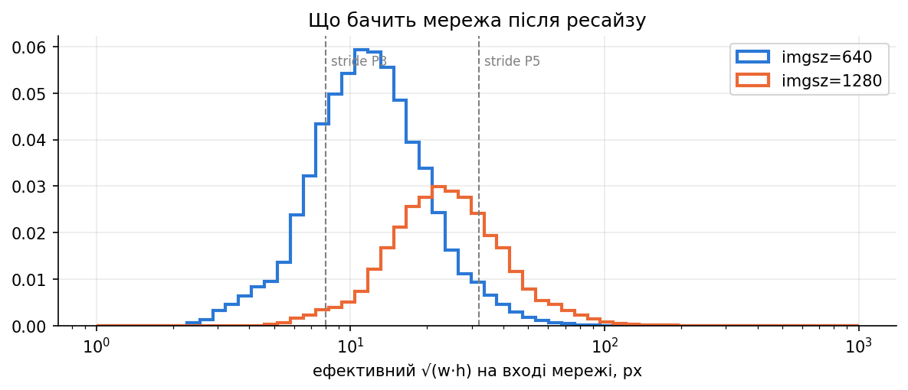
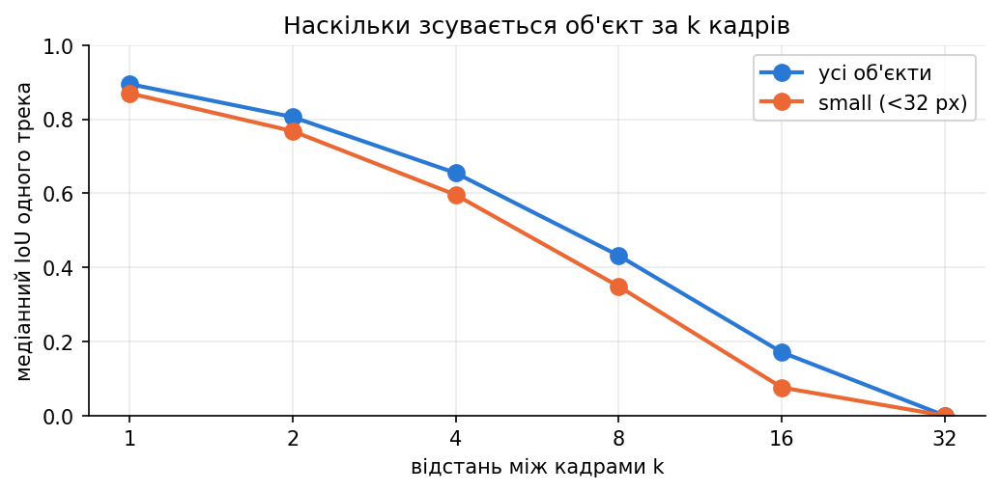
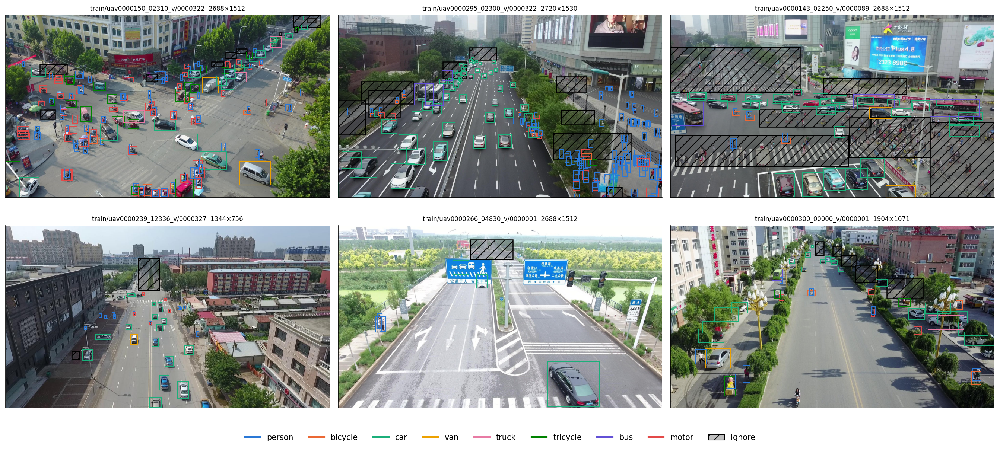

<!-- Своїми словами: обробка ignore і чому сірий 114 (той самий колір, що padding у letterbox/mosaic); перевірка конвертації
YOLO↔COCO (0 розбіжностей на 800 кадрах); ресайз (train ≤ 1600 px, мережа — imgsz), нормалізація, аугментації
(Ultralytics за замовчуванням: mosaic, flip, HSV, scale 0.5; torchvision — horizontal flip). -->

## 3. Validation protocol

- Split by sequence: provided `train` (56 clips) / `val` (7 clips), no shared clips; 5 clip-level folds saved in `code/results/folds_by_clip.csv`.
- Val: every 2nd frame (1 425 frames), original resolution.
- Metric: `pycocotools` COCOeval; ignore regions as `iscrowd=1` for all classes; ≤ 500 detections per frame; mAP taken at
  `maxDets=500` (`pycocotools` reports `stats[0]` at 100). Sanity check: ground truth as predictions → mAP = 1.000.
- Same protocol for every family: train every 4th frame, input long side 1024, seed 0.

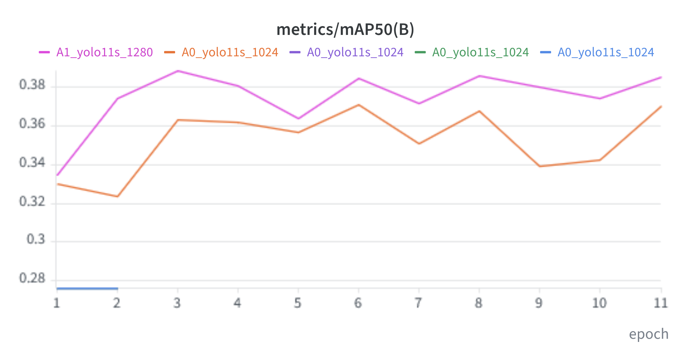

<!-- Поріг значущості: шум mAP між епохами на плато ≈ ±0.01, тому «приріст» < 1 п.п. не вважаємо доведеним. -->

## 4. Detector families

Val = our validation (COCO mAP@[.5:.95]); FPS — batch 1, fp16, one T4.

### 4.1 One-stage anchor-free — YOLO11 (Ultralytics, 10 epochs)

| Run | Change | mAP | AP50 | AP_small | AR500 | FPS | Public | Private |
|---|---|---|---|---|---|---|---|---|
| A0 | YOLO11s, 1024 (baseline) | 0.182 | 0.361 | 0.106 | 0.315 | 50.7 | 0.278 | 0.189 |
| A1 | imgsz 1280 | 0.191 | 0.379 | 0.111 | 0.318 | 48.4 | 0.285 | 0.201 |
| A2 | + P2 head (stride 4), 1024 | 0.185 | 0.366 | 0.108 | 0.336 | 41.5 | 0.193 | 0.181 |
| A4 | + P2 head, 1280 | 0.195 | 0.397 | 0.108 | 0.354 | 38.6 | 0.250 | 0.200 |
| A3 | YOLO11m, 1280 | **0.228** | **0.437** | **0.128** | 0.364 | 31.1 | 0.210 | 0.200 |

<!-- 1) Як локації призначаються об'єктам без якорів: Task-Aligned Assigner у YOLO11 — для кожного GT обираються top-k точок
усередині бокса за метрикою score^α · IoU^β; що це дає дрібним і щільним об'єктам. 2) Висновки: роздільна здатність — стабільний
приріст; P2 підняв recall, але не AP_small; найбільший ефект — розмір моделі. 3) Діапазон: imgsz {1024, 1280}, голова {P3–P5, P2–P5},
модель {s, m}. -->

### 4.2 Two-stage anchor-based — Faster R-CNN R50-FPN v2 (torchvision, 3 epochs)

| Run | Change | mAP | AP50 | AP_small | FPS | Public | Private |
|---|---|---|---|---|---|---|---|
| T0 | default: anchors 32–512, RPN 2000/1000 proposals, RoI 512 @ 25 % positives | 0.215 | 0.423 | 0.093 | 19.2 | 0.195 | 0.190 |
| T1 | anchors 8–128 + RPN 4000/2000 proposals | 0.189 | 0.399 | 0.086 | 13.8 | — | — |
| T2 | T1 + RoI sampling 256 @ 50 % positives | 0.186 | 0.395 | 0.084 | 13.6 | — | — |

| What each stage contributes (150 val frames) | T0 | T1 | T2 |
|---|---|---|---|
| RPN proposals per image | 1 000 | 2 000 | 2 000 |
| RPN recall @ IoU 0.5 | 0.739 | **0.891** | 0.884 |
| RPN recall @ IoU 0.7 | 0.522 | 0.535 | 0.543 |
| Final detections recall @ IoU 0.5 | 0.739 | 0.829 | 0.834 |
| Final detections recall @ IoU 0.5, score ≥ 0.3 | 0.677 | 0.731 | 0.752 |

| Error type (detections with score ≥ 0.3) | T0 | T1 |
|---|---|---|
| correct (TP) | 59.1 % | 46.1 % |
| wrong class | 12.8 % | 11.5 % |
| poor localisation | 7.2 % | 9.9 % |
| background | 20.4 % | 31.1 % |
| duplicate | 0.6 % | 1.5 % |

Most frequent confusions (GT → prediction): van → car, bicycle → motor, motor → person.

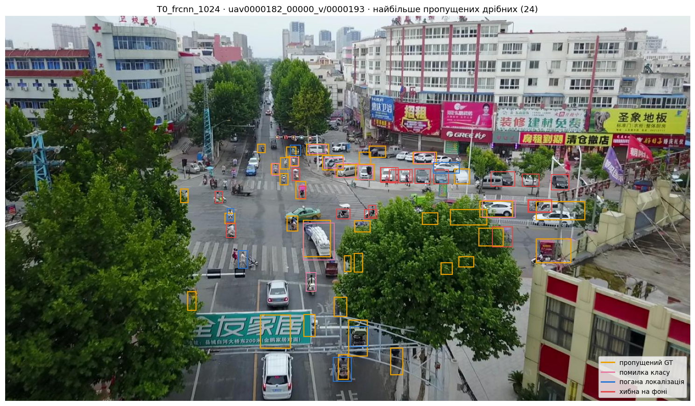
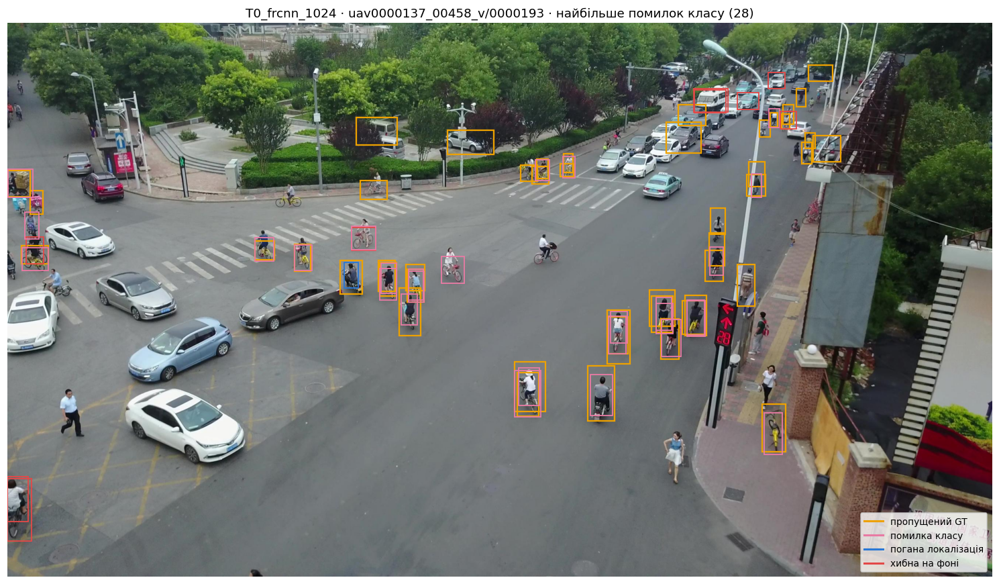
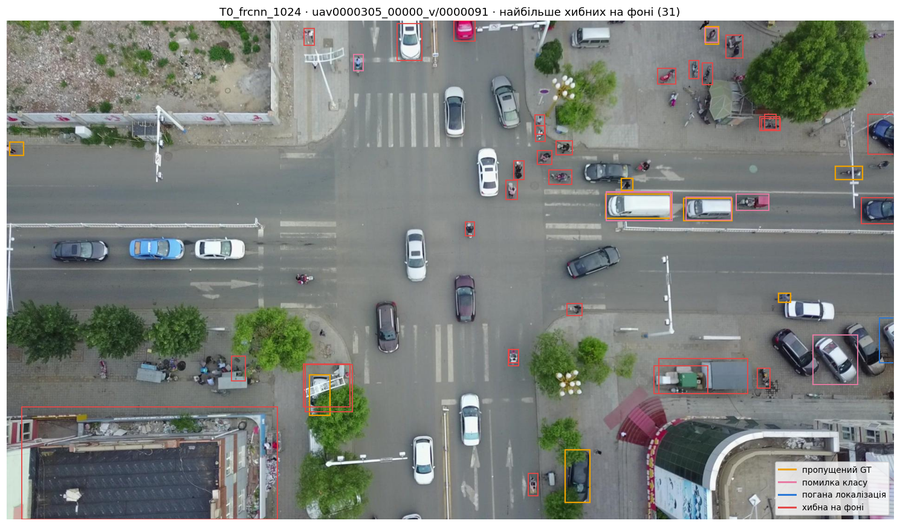

<!-- RPN дає кандидатів (recall), друга стадія класифікує і уточнює бокси: recall@0.5 не падає, а впевнені детекції лишають 68 %.
Три кейси помилок з картинок + правдоподібні причини: дрібні об'єкти в натовпі (<32 px, 1 клітинка P3), схожі класи згори
(van/car, bicycle/motor з райдером), текстури фону. T1: дрібні якорі + більше proposals підняли recall RPN з 0.74 до 0.89,
але друга стадія не впоралась з потоком нових кандидатів — хибних на фоні 20 % → 31 %, mAP −2.6 п.п.; AP_large впав (0.41 → 0.35),
бо найбільший якір тепер 128 px. T2 (більше позитивів у RoI-батчі) не змінив mAP у межах шуму. Висновок: вузьке місце —
не proposals, а класифікація другої стадії. -->

### 4.3 One-stage anchor-based — RetinaNet R50-FPN v2 (torchvision, 3 epochs)

| Run | Change | mAP | AP50 | AP_small | AP_large | FPS |
|---|---|---|---|---|---|---|
| R0 | default: anchors 32–512 (×3 scales), GIoU loss | **0.152** | **0.289** | **0.055** | **0.320** | 26.9 |
| R1 | anchors 8–128 (×3 scales), from EDA | 0.062 | 0.186 | 0.031 | 0.112 | 25.5 |
| R2 | R1 + CIoU loss | 0.060 | 0.184 | 0.032 | 0.113 | 25.9 |

<!-- Без proposal-стадії детектор оцінює ~100k якорів на кадр, майже всі — фон: дисбаланс → focal loss. Чому зменшені якорі
провалились (P3–P7 мають stride 8–128: якір 8 px на stride 8 і поріг IoU 0.5 дають мало позитивів, великим об'єктам бракує
якорів — AP_large 0.32 → 0.11). Як виправити: зберегти великі масштаби, додати малі (ширший діапазон), або ATSS-призначення.
CIoU не змінив результат. Порівняння з Faster R-CNN. -->

### 4.4 Query-based — RT-DETR-l (Ultralytics, 10 epochs, same budget as YOLO)

| Run | Change | mAP | AP50 | AP_small | AR500 | FPS | Public | Private |
|---|---|---|---|---|---|---|---|---|
| Q0 | 300 queries (default) | **0.268** | **0.514** | **0.139** | 0.411 | 15.2 | 0.310 | 0.249 |
| Q1 | 500 queries | 0.261 | 0.500 | 0.125 | 0.414 | 15.2 | 0.324 | 0.253 |

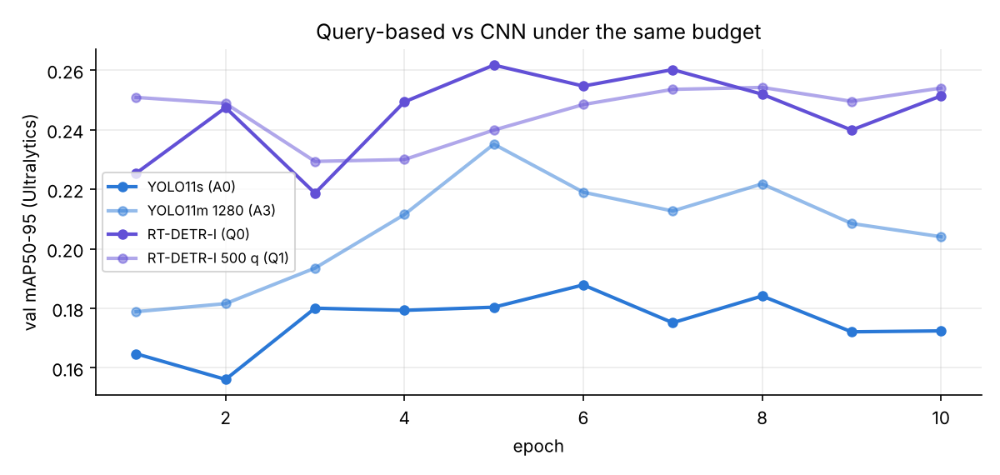

<!-- Bipartite matching (Hungarian): кожен GT отримує рівно один предикт → дублікати штрафуються на тренуванні, NMS не потрібен.
Що це змінює: повільніший старт навчання, зате немає придушення сусідів у щільних сценах. Крива: RT-DETR виходить на плато
~5-та епоха і весь час вище YOLO; модель зійшлася в межах бюджету (коливання ±0.01). 500 queries: на val не краще — 300 вистачає. -->

### 4.5 Comparison of families (best run of each, val)

| Family | Run | mAP | AP_small | AP_medium | AP_large | FPS |
|---|---|---|---|---|---|---|
| Query-based | Q0 | **0.268** | **0.139** | **0.231** | **0.456** | 15.2 |
| Anchor-free | A3 | 0.228 | 0.128 | 0.208 | 0.357 | 31.1 |
| Two-stage | T0 | 0.215 | 0.093 | 0.191 | 0.410 | 19.2 |
| One-stage anchor-based | R0 | 0.152 | 0.055 | 0.130 | 0.320 | 26.9 |

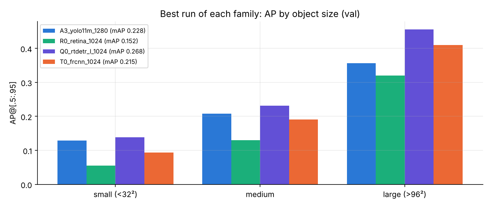
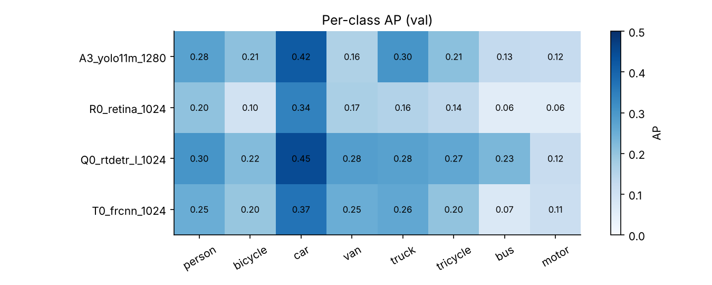

## 5. Final pipeline

| Step | What changes | mAP (val) | Public | Private |
|---|---|---|---|---|
| Q0 RT-DETR-l, 1024 | model | 0.268 | 0.310 | 0.249 |
| F1 RT-DETR-l retrained at 1280 | model (input resolution) | 0.271 | 0.324* | 0.259* |
| I0 Q0 weights, inference at 1280 | inference | 0.282 | 0.284 | 0.250 |
| E0 WBF Q0 + Q1 | inference (ensemble) | 0.274 | — | — |
| **E1 WBF Q0 ×2 + Q1 + A3 + T0** | inference (ensemble) | **0.294** | **0.329** | **0.272** |

\* submitted after the deadline, not counted.

**Public vs private LB.** Public disagreed with our val several times (A3 0.210 vs A1 0.285; I0 0.284 vs Q0 0.310), private
agrees with val (A3 ≈ A1 ≈ 0.20; I0 0.250 > Q0 0.249; E1 best). Checked and ruled out as causes: zero-height boxes (A3 without
them: unchanged), handling of ignore regions (val re-scored three ways: ranking unchanged).

<!-- Своїми словами: чому фінальні сабміти — E1 (найкращий на val) і Q1 (найкращий окремий на public); чому ансамбль різних
сімейств (трансформер + anchor-free CNN + two-stage) дає більше, ніж два схожі RT-DETR (+0.5 проти +2.6 п.п.);
що public виявився шумним, а наш val — надійнішим. -->

## 6. Bonus tasks

**Data temporality.** For every detection, the max score of a same-class box with IoU ≥ τ in the neighbouring ±w frames is
averaged and blended with its own score: s' = (1 − α)·s + α·support. Grid on val (A1): w ∈ {1, 2}, τ ∈ {0.3, 0.5}, α ∈ {0.2, 0.4, 0.6}.

| Config | mAP (val) | Δ |
|---|---|---|
| A1, no rescoring | 0.191 | — |
| best: w = 1, τ = 0.3, α = 0.2 | 0.189 | −0.15 pp |
| worst: w = 2, τ = 0.5, α = 0.6 | 0.173 | −1.75 pp |

<!-- Чому не допомогло: YOLO вже стабільний між кадрами, тож підтримка сусідів лише стискає розкид score і псує ранжування;
хибні детекції на нерухомому фоні теж повторюються в сусідніх кадрах. Що спробувати далі: компенсація руху камери, трекер. -->

**Visualization.** W&B project (training curves, configs, validation predictions with boxes for every model):
<!-- посилання на W&B -->. RoI-feature embeddings of Faster R-CNN (t-SNE):

<!-- 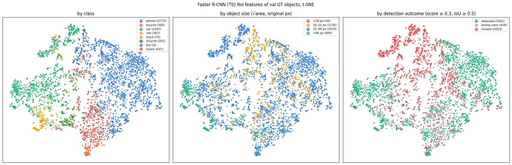 — після ноутбука 11, і 3–4 речення: що видно (кластери класів, де лежать пропущені,
які класи змішуються) і який висновок. -->

**Custom architecture.** P2 detection head (stride 4) for YOLO11s: A0 → A2 (1024) +0.2 pp, A1 → A4 (1280) +0.4 pp mAP;
recall +2…+3.6 pp, AP_small unchanged.

<!-- Своїми словами: навіщо P2 (EDA: 17 % об'єктів < 16 px при 1024), чому не спрацювало (нові шари голови з нуля + 10 епох;
у 10-px об'єкта мало інформації незалежно від кроку карти; більше хибних детекцій), що висновок: на цій задачі ємність моделі
(s → m: +3.7 pp) важливіша за додатковий рівень FPN. -->

## 7. Reproducibility

Notebooks in `code/notebooks/` (table and run order in `code/README.md`). The final submission: run 05 (Q0, Q1), 03 (A3),
04 (T0) on Kaggle (GPU T4 ×2, Internet on, W&B key in Kaggle Secrets), then 08 with their Outputs as Input → `submission_wbf.csv`.
Seed 0, `deterministic=True`; ultralytics 8.4.213, torch 2.11.0, Python 3.13 (Kaggle), pycocotools, ensemble-boxes.
All runs: `code/results/experiments.csv`; per-run metrics and curves: `code/results/runs/`.

## References

Ultralytics YOLO11 and RT-DETR; torchvision detection models; pycocotools; ensemble-boxes (WBF);
Ren et al., *Faster R-CNN*; Lin et al., *Focal Loss for Dense Object Detection*; Zhao et al., *DETRs Beat YOLOs (RT-DETR)*;
Solovyev et al., *Weighted Boxes Fusion*; Zheng et al., *Distance-IoU Loss*; Zhu et al., *VisDrone*; Feng et al., *TOOD*.
